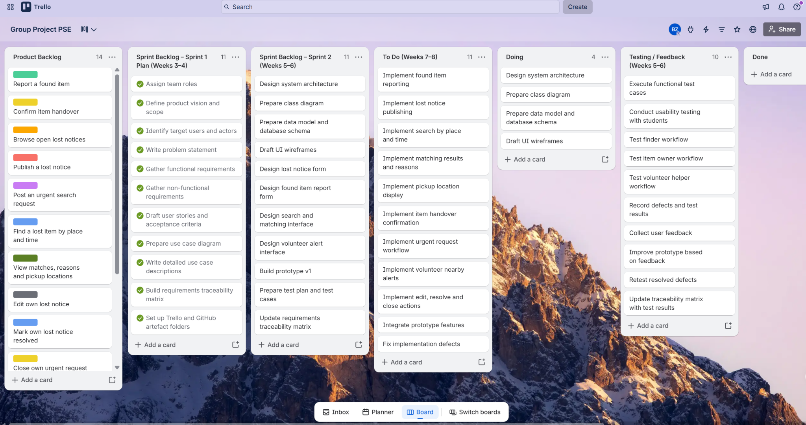
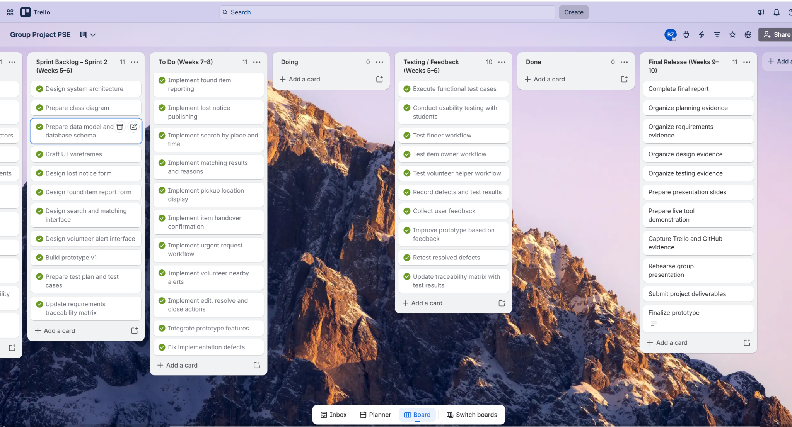
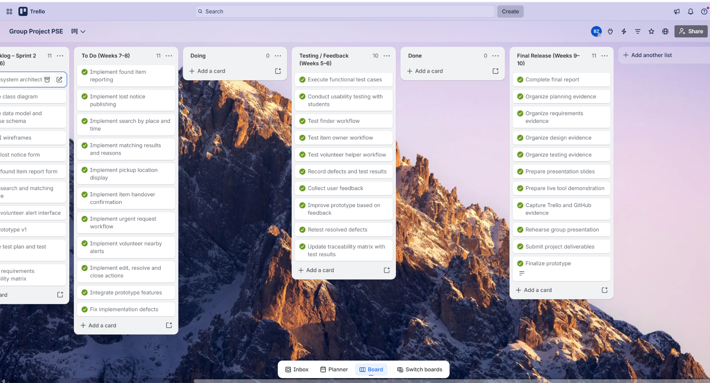

# Development Methodology and Work Plan

## Methodology

The project combines Agile software development with iterative prototyping. This approach was selected because the semester delivery window was short, the five team members needed to work in parallel, and the route-and-time matching rules required repeated validation.

The methodology supported:

- incremental delivery, beginning with reporting and route search before adding notices, handover and urgent alerts;
- early verification of room aliases, multiple visit intervals and result-ranking rules;
- parallel work on requirements, diagrams, implementation and testing;
- repeated review, correction and regression testing.

## Trello workflow

The board was organised into Product Backlog, Sprint Backlog, To Do, Doing, Done, Testing/Feedback and Final Release. A card moved through these lists as it was selected, implemented, tested, improved and prepared for submission.

## Timeline

| Period | Planned work | Main outputs |
| --- | --- | --- |
| Weeks 3–4 | Translate approved requirements into architecture, data design, UI layouts and Prototype v1. Prepare the test plan and initial RTM. | Requirements, diagrams, wireframes, early prototype, planned tests |
| Weeks 5–6 | Integrate reporting, search, matching reasons, pickup points, notices, handover, urgent requests and volunteer alerts. Execute functional and usability tests. | Integrated prototype, test results, fixes and regression evidence |
| Weeks 7–8 | Fix high-priority issues, retest major workflows and assemble the final report, presentation, GitHub evidence and demo. | Stable prototype and final submission package |

## Tools and technology

| Tool | Use in the project |
| --- | --- |
| Trello | Sprint and task tracking across the SDLC |
| GitHub | Version control and evidence repository |
| Draw.io / Diagrams.net | Editable use-case, architecture and workflow diagrams |
| Figma | Desktop and mobile UI/UX reference designs |
| Visual Studio Code | Prototype development and source review |
| HTML, CSS and JavaScript | Responsive browser interface |
| Python HTTP service | Validation, matching and API behaviour |
| SQLite | Persistent storage for reports, notices, urgent requests and submission receipts |

## Planning evidence

