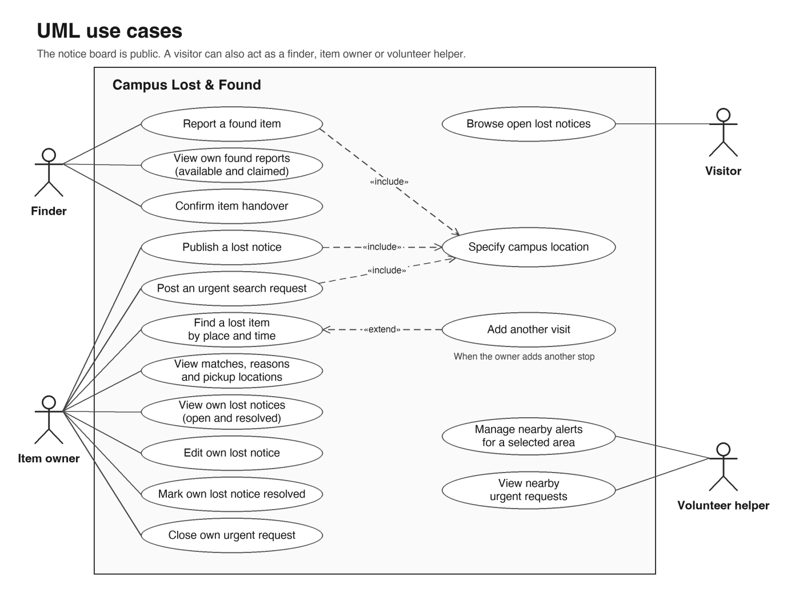

# Use-Case Descriptions

| Actor and use case | Main flow and outcome | Alternative or exception |
| --- | --- | --- |
| Visitor — Browse Open lost notices | Open the public board and browse notices that remain Open. | No sign-in is needed; Resolved notices leave the board. |
| Finder — Report a found item | Enter item, location, time and collection point, then submit. | Correct invalid details and retry; success creates an Available report. |
| Finder — View own found reports | Open My found reports in the submitting browser. | Available and Claimed records associated with that browser remain visible. |
| Finder — Confirm item handover | Select an Available report and confirm handover. | Cancel leaves it Available; confirm marks it Claimed and removes it from matching. |
| Item Owner — Find an item by place and time | Select type and enter one or more timed visits; optionally add colour. | Invalid entries must be corrected; a valid search may return zero or more matches. |
| Item Owner — View matches and pickup locations | Review ranking, match reasons and collection points. | An empty result displays “No matching reports.” |
| Item Owner — Publish a lost notice | Enter item, last-seen place/time and description. | Success adds an Open notice to the public board and My notices. |
| Item Owner — View own lost notices | Open My notices in the submitting browser. | Open and Resolved notices both remain visible. |
| Item Owner — Edit own lost notice | Select an Open notice, update and save. | Credential is checked; Resolved notices cannot be edited. |
| Item Owner — Resolve own lost notice | Select an Open notice and confirm resolution. | It leaves the public board and remains under My notices. |
| Item Owner — Post an urgent request | Enter item, venue, exact spot and identifying details. | Success creates an active request for up to 30 minutes. |
| Item Owner — Close own urgent request | Close it from its originating browser tab. | Missing or invalid management credentials leave the record unchanged. |
| Volunteer Helper — Manage nearby alerts | Select a place and start, change or stop reception. | Invalid or incomplete locations pause polling; changing place clears the list. |
| Volunteer Helper — View nearby requests | Review active requests for the selected area. | Closed or expired requests disappear; an empty list shows “No active requests.” |

### Relationships

Specifying a campus location is included by found-item reporting, lost-notice publication and urgent-request publication. Adding another visit extends the basic route-search flow because one visit is sufficient and additional visits are optional.

