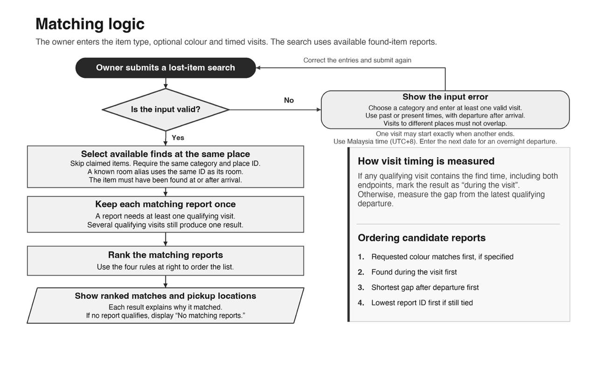

# Route-Matching Logic

1. The owner submits an item type, optional colour and one or more visits in Malaysia Time (UTC+8).
2. Each visit must have valid arrival and departure times, must not be in the future, and must not overlap another location’s interval.
3. Room aliases are resolved to canonical campus place IDs.
4. Only Available reports with the same item type and exact resolved place are considered.
5. The found date must be on or after the visit arrival date; a report matching multiple visits appears once.
6. Results rank by exact colour match, found-during-visit status, shortest time after departure and lowest report ID.
7. The interface displays the reason and collection point for every match, or “No matching reports.”

Colour changes ranking but does not exclude otherwise valid candidates. A report found shortly after an owner left can still match because the item may have remained at the location.

