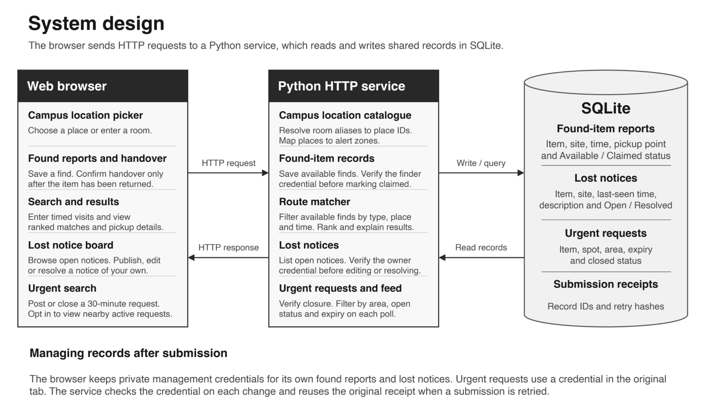

# System Architecture

| Component | Responsibility |
| --- | --- |
| Web browser | Presents location pickers, forms, ranked results, the public board and urgent-request feed. |
| Python HTTP service | Validates requests, resolves aliases, maps alert areas, ranks matches and checks management credentials. |
| SQLite database | Stores found-item reports, lost notices, urgent requests and submission receipts. |

All clients using the same service instance share the same SQLite records. Found reports and lost notices keep management credentials in browser storage, while urgent requests keep theirs in the originating tab’s session storage. The service verifies the relevant credential before changing a record.

The record lifecycles are independent:

- Available found report → Claimed after confirmed handover;
- Open lost notice → Resolved after owner confirmation;
- active urgent request → closed by the owner or expired after 30 minutes.

A repeated submission with the same valid key and details reuses the existing record instead of creating a duplicate.

