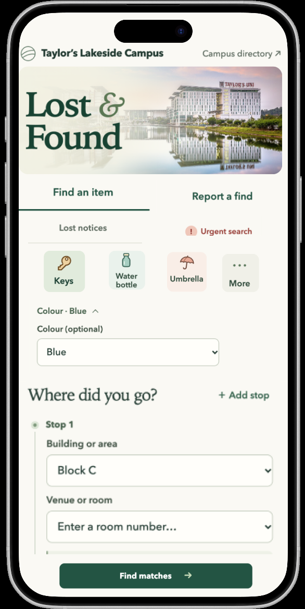
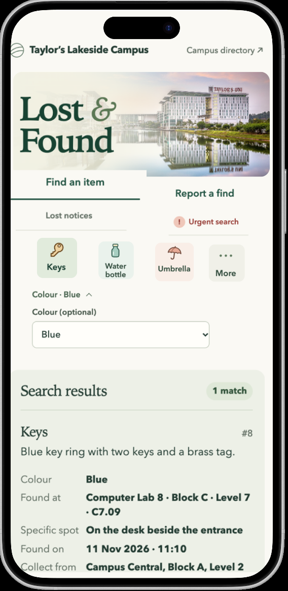
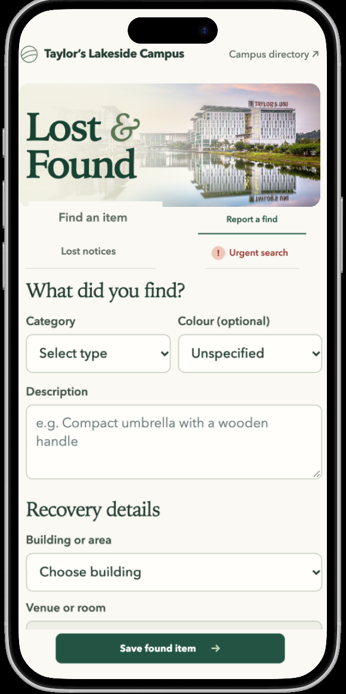
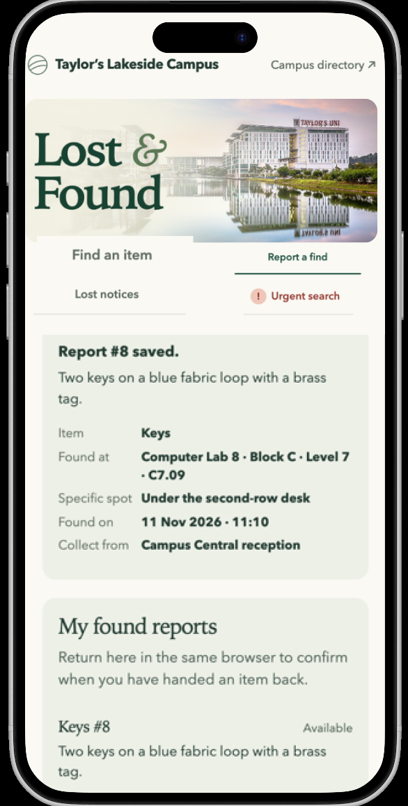
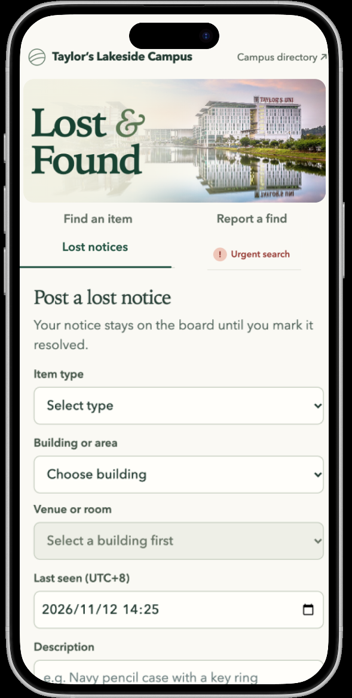
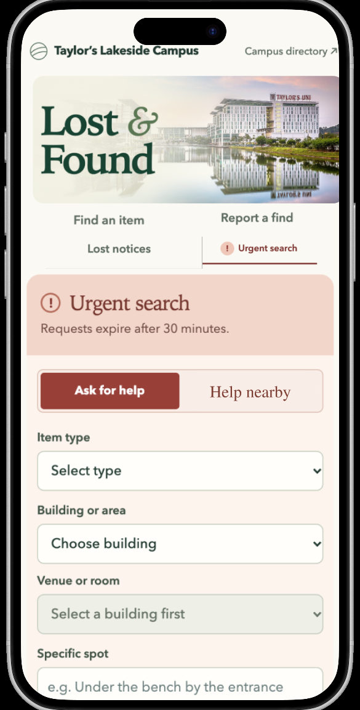
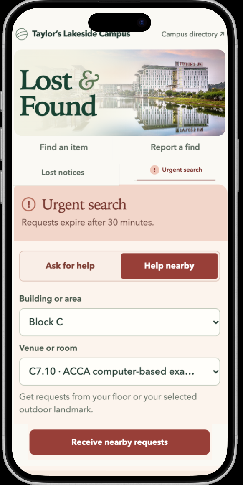

# UI/UX Design Evidence

The interface uses one responsive page for desktop and mobile. Its navigation follows the four core modules and its campus-place controls use structured selections rather than free-form location text.

## Find an item

## Report a find

## Lost notices

## Urgent search and volunteer reception

