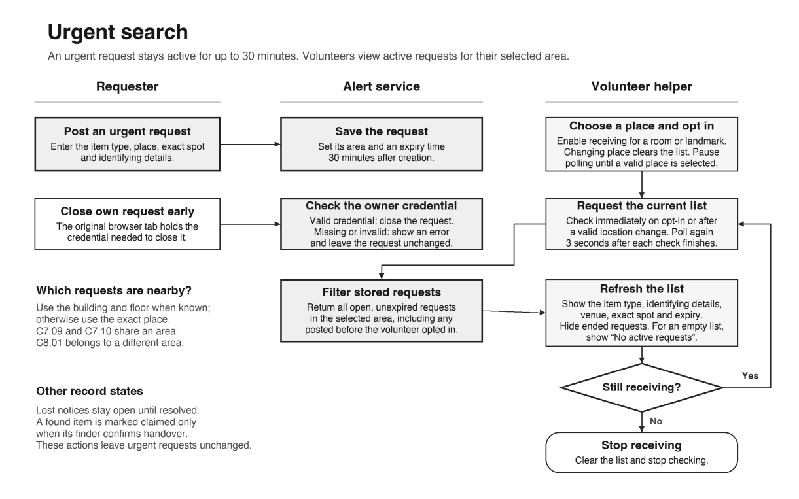

# Urgent-Search Workflow

The owner submits an item type, campus venue, exact spot and identifying details. The service maps the venue to an alert area and keeps the request active for 30 minutes unless the originating tab closes it earlier.

Volunteers select a room or landmark and enable reception. The browser checks immediately and then approximately every three seconds. Classroom requests are grouped by building and floor, so a C7.09 request can reach a volunteer in C7.10. Outdoor landmarks require an exact location match.

Changing volunteer location clears the existing list, cancels pending checks and begins checking the new area. Closed and expired requests disappear; an empty feed displays “No active requests.”

