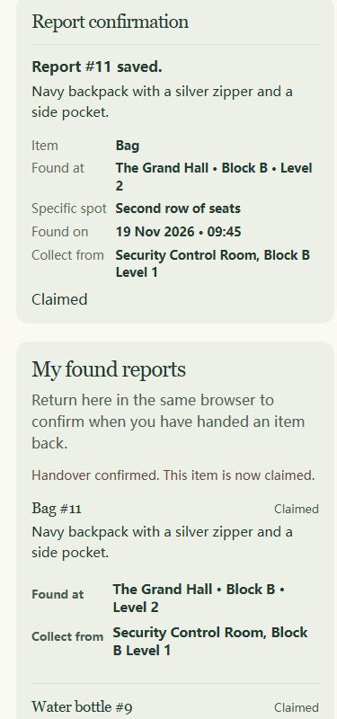
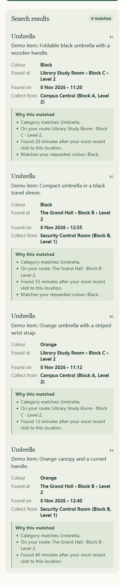
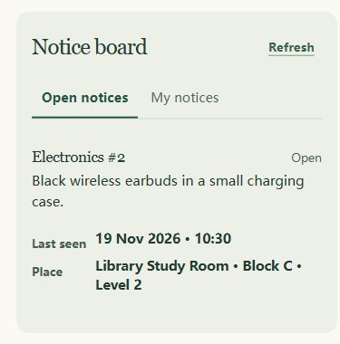
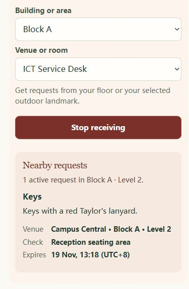
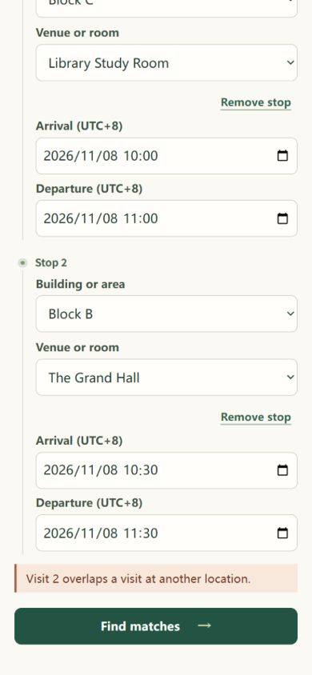
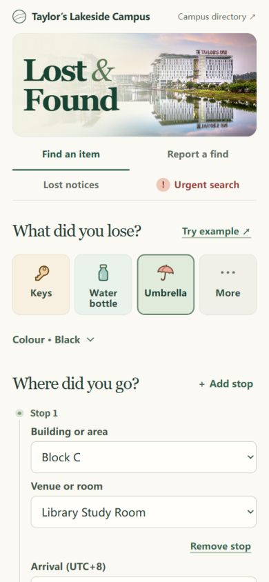
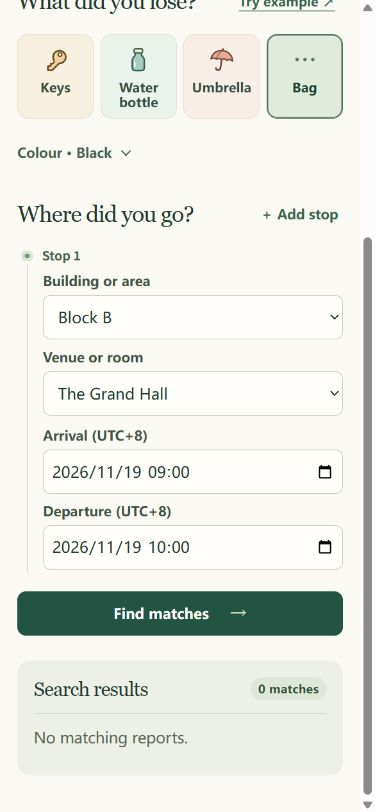
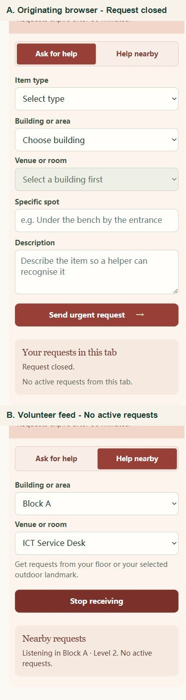

# Campus Lost & Found — Test Record

This document records the executed functional, mobile, reliability, and service-level tests for the Taylor's University Lakeside Campus Lost & Found prototype.

## 1. Test scope

The test execution covered four user-centred workflows:

- Finder: report a found item and confirm its handover.
- Item Owner: search a timed campus route and manage lost notices or urgent requests.
- Volunteer Helper: select a campus location and receive relevant nearby requests.
- Visitor: browse public lost notices without creating an account.

The execution also covered input validation, SQLite persistence, duplicate-submission protection, mobile responsive behaviour, request duration, and urgent-request polling.

## 2. Test environment

| Component | Tested configuration |
|---|---|
| Test date | 19 November 2026 |
| Operating system | Microsoft Windows 11 Home, 64-bit |
| Application runtime | Portable Python 3.13.17 |
| Database | SQLite 3.50.4 |
| Browser | Chromium-based browser |
| Mobile viewport | 390 × 844 CSS pixels |
| Application mode | Local server |

## 3. Execution summary

| Test category | Executed | Passed | Failed |
|---|---:|---:|---:|
| Found-item reporting, route search, and handover | 8 | 8 | 0 |
| Lost notice board | 4 | 4 | 0 |
| Urgent requests and volunteer reception | 5 | 5 | 0 |
| Non-functional and reliability checks | 7 | 7 | 0 |
| **Total** | **24** | **24** | **0** |

All 24 executed checks met their scoped acceptance criteria. This does not mean that every requirement was fully verified: NFR-02 remains partially verified because the 56 ms measurement covered HTTP request duration rather than complete browser rendering time, and NFR-04 remains partially verified because the recorded responsive test covered a mobile viewport but not a documented desktop viewport.

## 4. Functional test records

| ID | Requirement | Test procedure | Actual result | Status |
|---|---|---|---|---|
| TC-F01 | FR-01 | At 390 × 844, report a blue Bag found at The Grand Hall, Block B Level 2, at 09:45. Use the description “Navy backpack with a silver zipper and a side pocket”, the spot “Second row of seats”, and the Security Control Room collection point. | Report #11 was saved and its recovery details were displayed. | Pass |
| TC-F02 | FR-02 | Open Bag #11 under **My found reports**, select **Confirm handover**, and confirm the final action. | Bag #11 changed from Available to Claimed and a handover confirmation was displayed. | Pass |
| TC-F03 | FR-03, FR-05 | Search for a black Umbrella with visits to Library Study Room and The Grand Hall. | Four eligible umbrella reports were displayed in ranked order with collection locations and matching explanations. | Pass |
| TC-F04 | FR-05 | Compare colour match, discovery timing, minutes after departure, and record order. | Black matches appeared before orange matches; timing and route explanations appeared for each result. | Pass |
| TC-F05 | FR-04 | Submit two visits whose time intervals overlap at different locations. | The interface displayed “Visit 2 overlaps a visit at another location.” | Pass |
| TC-F06 | FR-04 | Submit a departure time earlier than its arrival time. | The request was rejected with an instruction that the visit must end after it starts. | Pass |
| TC-F07 | FR-04 | Submit a visit containing a future timestamp. | The request was rejected with a message explaining that the arrival cannot be in the future in Malaysia (UTC+8). | Pass |
| TC-F08 | FR-02 | Repeat a route search after the corresponding report has been marked Claimed. | The claimed report was absent and the test search returned no matching report. | Pass |
| TC-F09 | FR-06 | Open **Lost notices** and view **Open notices** without signing in. | Electronics notice #2 appeared publicly without authentication. | Pass |
| TC-F10 | FR-07 | Publish Electronics notice #2 for black wireless earbuds last seen in Library Study Room at 10:30. | The notice appeared with its description, time, and Block C Level 2 location. | Pass |
| TC-F11 | FR-08 | Edit an owned open notice from **My notices**. | The revised content was accepted and retained for the originating browser. | Pass |
| TC-F12 | FR-08 | Mark an owned notice Resolved and confirm the action. | The record remained in **My notices** and was removed from the public board. | Pass |
| TC-F13 | FR-09 | Post a Keys urgent request at Campus Central, Block A Level 2, with the spot “Reception seating area”. | A request with a visible 30-minute expiry was created. | Pass |
| TC-F14 | FR-10 | Select ICT Service Desk, Block A Level 2, and enable nearby-request reception. | The same-floor Campus Central Keys request appeared in the volunteer feed. | Pass |
| TC-F15 | FR-10 | Stop receiving and then enable receiving again. | The button and feed state changed consistently between the two modes. | Pass |
| TC-F16 | FR-09 | Close the urgent request from its originating browser tab. | The requester view displayed “Request closed”, and the request was removed from the active feed. | Pass |
| TC-F17 | FR-10 | Keep nearby reception enabled and observe the automatic refresh. | A relevant request appeared during the next refresh cycle. The implementation schedules the next poll 3000 ms after the previous request finishes. | Pass |

## 5. Non-functional and reliability test records

| ID | Requirement | Test procedure | Actual result | Status |
|---|---|---|---|---|
| TC-N01 | NFR-01 | Review navigation, structured location controls, required fields, and validation messages at the mobile viewport. | The four functions remained identifiable and validation feedback was visible without developer tools. | Pass |
| TC-N02 | NFR-02 | Measure the duration of a valid local `/api/search` HTTP request. | The HTTP request completed in 56 ms. This measurement excludes complete browser rendering time. | Pass — service-level scope |
| TC-N03 | NFR-02 | Enable reception, create a relevant request, and observe when it appears in the volunteer feed. | The request appeared after approximately 3.52 seconds. The code uses a 3000 ms delay after the preceding request finishes, so the start-to-start interval can be slightly longer than three seconds. | Pass |
| TC-N04 | NFR-03 | Inspect the SQLite schema after completing the workflows. | `items`, `lost_notices`, `alerts`, and `submissions` contained the required stored records. | Pass |
| TC-N05 | NFR-03 | Submit the same payload twice with the same valid submission key. | Both attempts returned the original record ID; no duplicate logical record was created. | Pass |
| TC-N06 | NFR-03 | Start a fresh service process against the same SQLite database and retrieve existing records. | Previously committed records and their states remained accessible. | Pass |
| TC-N07 | NFR-04 | Operate all four modules at a 390 × 844 simulated mobile viewport and inspect horizontal overflow. | The interface remained single-column, readable, and operable without unexpected horizontal scrolling. Desktop viewport behaviour was not measured by this test. | Pass — mobile scope |

## 6. Findings and regression results

The following entries distinguish observed behaviour from identified risks and preventive improvements.

### 6.1 Risk identified: duplicate submissions

If the server commits a create request but the browser does not receive the response, an ordinary retry could create a duplicate record.

The reliability control accepts a 64-character hexadecimal submission key. The server stores the endpoint, a SHA-256 hash of the submission key, a SHA-256 hash of the submitted JSON data, and the resulting record ID in the SQLite `submissions` table. The original key is not stored in clear text.

Regression result: submitting the same endpoint, key, and data returned the original record ID. Reusing the key with different data was treated as a conflict.

### 6.2 Preventive quality improvement: final-state actions

A single mobile tap could otherwise move a record to a final state accidentally. Handover and notice resolution therefore use a second confirmation step and require the browser-held management credential.

Regression result: the record changed state only after the explicit second confirmation.

### 6.3 Risk identified: irrelevant or stale alerts

Volunteer helpers should not receive requests from unrelated floors or requests that have expired or been closed.

The prototype groups requests by building and floor or exact outdoor landmark, applies a 30-minute expiry, allows early closure, and refreshes only while reception is enabled.

Regression result: the ICT Service Desk helper received the Campus Central request because both locations belong to Block A Level 2. After early closure, the volunteer feed reported no active requests.

### 6.4 UI improvement: mobile form density

Responsive rules collapse forms, cards, and results into a single column at narrow widths.

Regression result: the four workflows remained readable and operable at 390 × 844 without unexpected horizontal scrolling.

## 7. Requirements traceability

| Requirement | Test cases | Evidence | Verification status |
|---|---|---|---|
| FR-01 | TC-F01 | Bag 11 receipt | Verified |
| FR-02 | TC-F02, TC-F08 | Claimed state and exclusion from later search | Verified |
| FR-03 | TC-F03 | Two-stop route search | Verified |
| FR-04 | TC-F05, TC-F06, TC-F07 | Overlap, invalid-order, and future-time validation | Verified |
| FR-05 | TC-F03, TC-F04 | Four ranked matches with explanations and collection points | Verified |
| FR-06 | TC-F09 | Public notice board without login | Verified |
| FR-07 | TC-F10 | Electronics notice 2 | Verified |
| FR-08 | TC-F11, TC-F12 | Edited and resolved owner-managed notice | Verified |
| FR-09 | TC-F13, TC-F16 | 30-minute expiry and early closure | Verified |
| FR-10 | TC-F14, TC-F15, TC-F17 | Same-floor feed, reception control, and refresh observation | Verified |
| NFR-01 | TC-N01 | Mobile navigation and validation feedback | Verified |
| NFR-02 | TC-N02, TC-N03 | 56 ms HTTP request and approximately 3.52-second feed observation; complete render latency not instrumented | Partially verified |
| NFR-03 | TC-N04, TC-N05, TC-N06 | SQLite storage, idempotent retry, and fresh-process retrieval | Verified |
| NFR-04 | TC-N07 | 390 × 844 mobile test; documented desktop test not executed | Partially verified |

## 8. Screenshot evidence

### Figure 9.1 — Mobile found-item receipt and Claimed status for Bag #11

### Figure 9.2 — Four ranked Umbrella matches and matching explanations

### Figure 9.3 — Public Electronics notice #2

### Figure 9.4 — Same-floor Keys request at ICT Service Desk

### Figure 9.5 — Overlapping visit validation

### Figure 9.6 — Mobile responsive layout at 390 × 844

### Figure 9.7 — Claimed item excluded from subsequent search results

### Figure 9.8 — Urgent request closed and removed from the active feed

## 9. Limitations and follow-up tests

- The 56 ms result is an HTTP request-duration measurement, not a complete click-to-render measurement.
- The responsive-layout test used a simulated 390 × 844 viewport; a documented desktop viewport test is still required for complete NFR-04 verification.
- The test did not cover high concurrency, production network latency, physical Android/iOS devices, or assistive-technology compatibility.
- Future work should add browser Performance API timing for click-to-render latency and a desktop test such as 1366 × 768.

## 10. Conclusion

All 24 executed checks passed within their stated scope. Twelve requirements were fully verified. NFR-02 and NFR-04 remain partially verified because complete browser-rendering latency and a documented desktop viewport test were not included in the recorded measurements.
