# Prototype Implementation and Demonstration

## Environment

| Component | Implementation |
| --- | --- |
| Browser interface | HTML, CSS and JavaScript forms, lists and responsive layout |
| Service | Python HTTP server for validation, APIs and matching |
| Storage | SQLite for reports, notices, requests and receipts |
| Windows launch | `Start.cmd` runs the bundled 64-bit Python runtime |

To run on Windows, open [Prototype](Prototype/), double-click `Start.cmd`, keep the terminal open and use the browser URL displayed by the launcher. Detailed instructions are in [Prototype/README.md](Prototype/README.md).

## Environment evidence

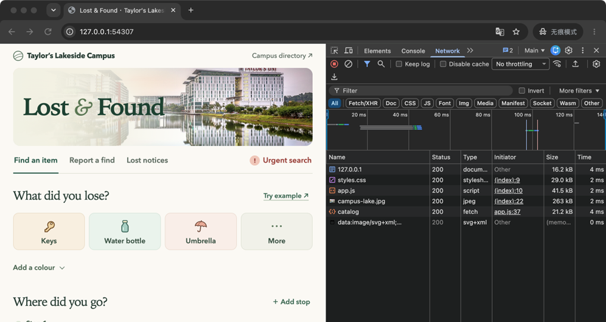

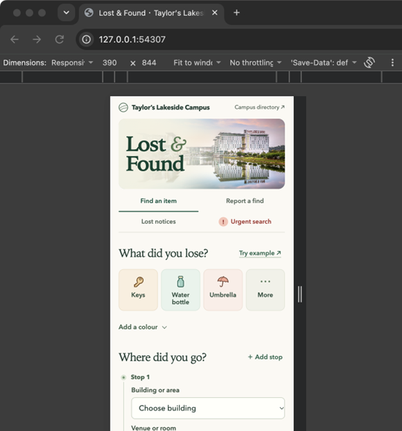

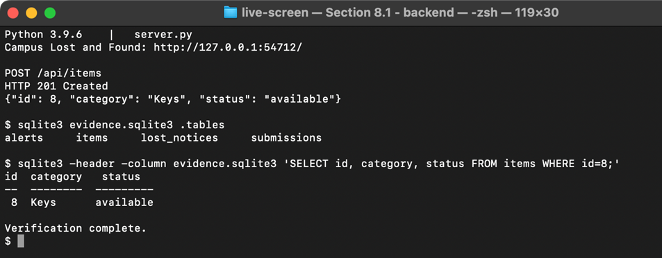

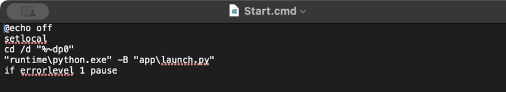

## Implemented modules

| Module | Requirements | Behaviour |
| --- | --- | --- |
| Report a find | FR-01–02 | Create an Available report, record a pickup point and later mark it Claimed. |
| Find an item | FR-03–05 | Search timed visits and show ranked results, explanations and pickup locations. |
| Lost notices | FR-06–08 | Publish an Open notice, then edit or resolve it from the originating browser. |
| Urgent search | FR-09–10 | Send a 30-minute request and show relevant requests to opted-in nearby volunteers. |

## Matching implementation evidence

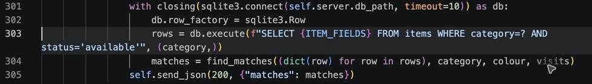

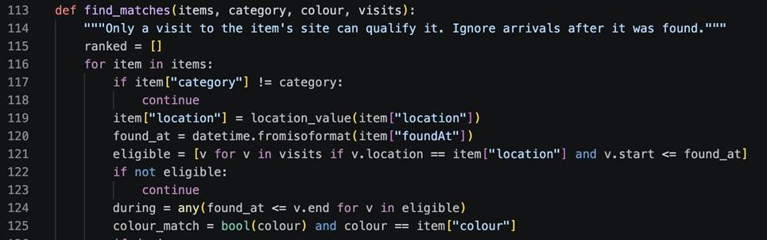

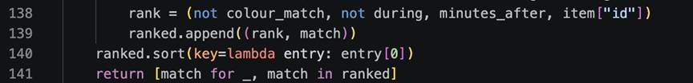

## End-to-end demonstrations

### Report, search and handover

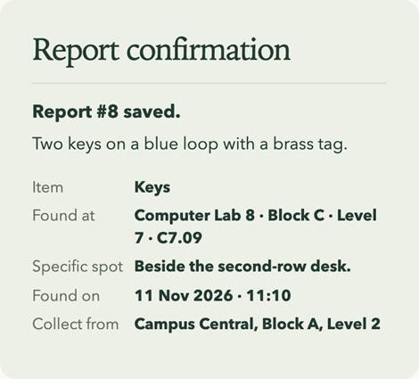
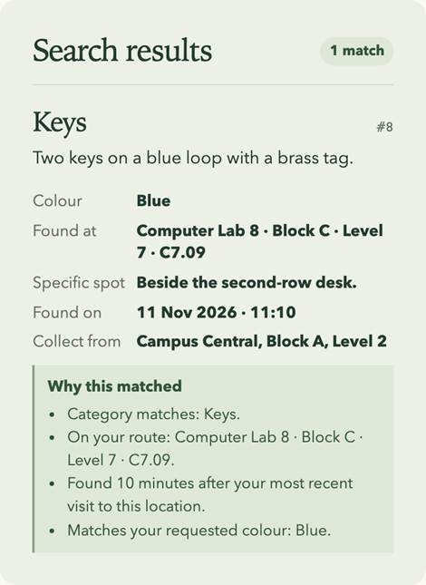
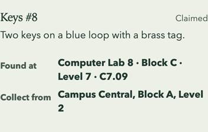

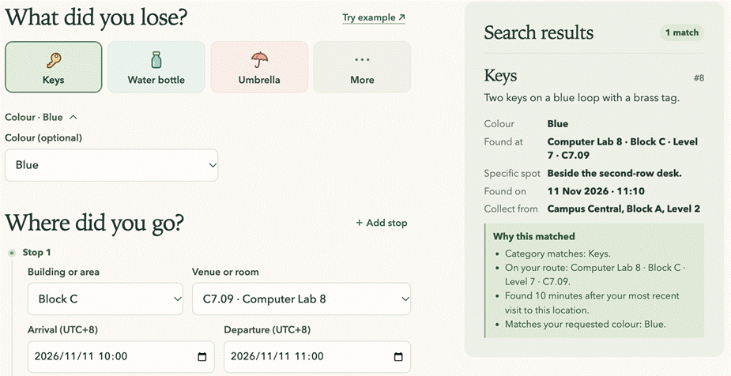
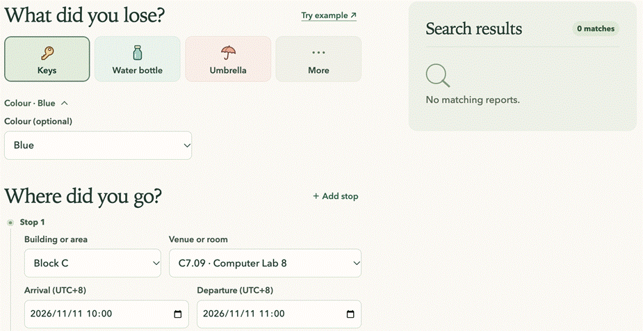

### Lost-notice resolution

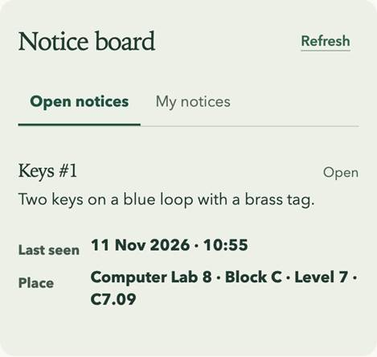
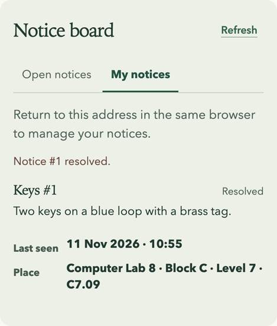
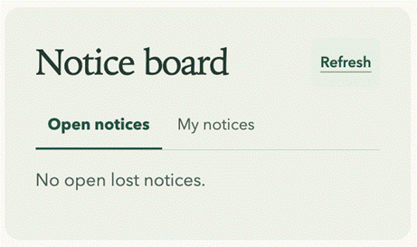

### Nearby-volunteer request

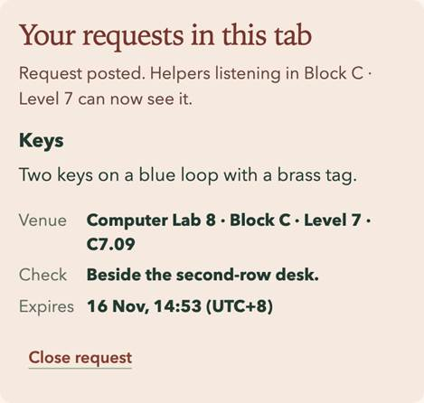
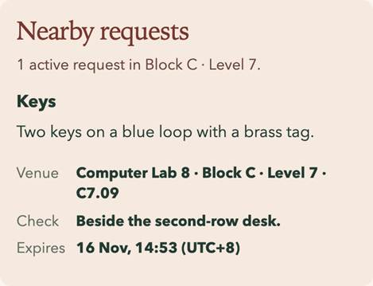
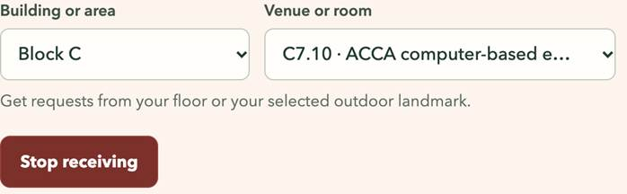

For the controlled test execution, expected/actual results and requirement coverage, see [04-Test](../04-Test/README.md).

